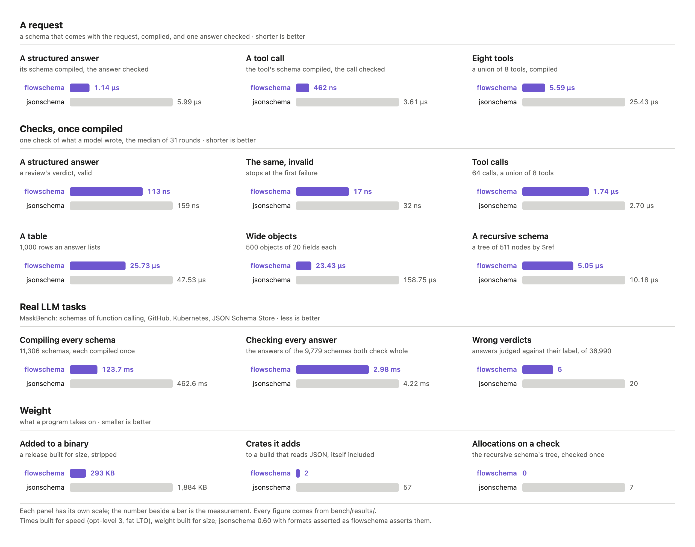

<h1 align="center">flowschema</h1>

<p align="center">
  <strong>JSON Schema for agents: tool calls and structured output, checked as models write them</strong><br>
  Drafts 4 to 2020-12 · 2 dependencies · 293 KB · no allocation on a check · a request checked 7.8× faster than jsonschema
</p>

<p align="center">
  <a href="https://github.com/localixai/flowschema/actions/workflows/ci.yml"></a>
  <a href="LICENSE"></a>
</p>

<p align="center">
  <a href="docs/agents.md"><b>In an agent</b></a> ·
  <a href="docs/api.md">API</a> ·
  <a href="docs/conformance.md">Conformance</a> ·
  <a href="docs/comparison.md">Comparison</a> ·
  <a href="CHANGELOG.md">Releases</a>
</p>

An agent meets JSON Schema twice: in a tool's parameters, which every call the model writes must
fit before the tool runs, and in the shape of a structured answer. Both schemas arrive at run
time, the data comes from a model, and what the program does with a failure is tell the model
what to fix. flowschema compiles a schema in about a microsecond, checks a call or an answer
against it with no allocation, and says what is wrong in words a model can mend its answer from:

```text
data.issues[0].line must be >= 1 (is 0)
data.issues[0].severity must be one of ["low","medium","high"] (is "urgent")
data must match exactly one schema of oneOf (matches none)
```

```toml
[dependencies]
flowschema = { git = "https://github.com/localixai/flowschema", tag = "v0.1.0" }
```

```rust
use flowschema::Schema;
use serde_json::json;

let schema = Schema::new(&json!({
    "type": "object",
    "required": ["verdict"],
    "properties": {"verdict": {"enum": ["approve", "request_changes"]}}
}));
assert!(schema.matches(&json!({"verdict": "approve"})));
assert_eq!(
    schema.mismatches(&json!({"verdict": "maybe"})),
    [r#"data.verdict must be one of ["approve","request_changes"] (is "maybe")"#]
);
// What the schema asks that is not checked here, each named once: none for this one.
assert!(schema.unchecked().is_empty());
```

## Why

- **Made for a schema that comes with the request.** An agent's schemas arrive at run time,
  often one with every request, so what a request costs is its schema compiled and one answer
  checked. For a tool call that is 462 ns, where the `jsonschema` crate takes 3.61 µs (7.8×);
  for a structured answer, 1.14 µs against 5.99 µs (5.2×). The schema is read where it is and
  not copied, so there is no cache to keep.
- **Fast to compile, fast to check.** On MaskBench's 11,306 schemas of real LLM tasks
  flowschema compiles 3.74× faster than `jsonschema` (123.7 ms against 462.6 ms) and checks
  every answer of the 9,779 both check whole 1.41× faster (2.98 ms against 4.22 ms), both built
  for speed. Once compiled, a review's verdict is checked in 113 ns and a union of 64 tool calls
  in 1.74 µs, beside 159 ns and 2.70 µs; no typical check, compile, request or message is slower.
- **No allocation.** A check allocates nothing, valid data or not; the benchmarks count every
  allocation and fail a run that makes one.
- **Messages a model can act on.** Each says where the value is, the rule it breaks and what the
  data has; `matches` writes nothing, and only data that failed is walked again for its messages.
- **Fitted to a provider.** A strict mode holds a model to part of JSON Schema: `fit` gives the
  schema OpenAI, Anthropic or Gemini takes and says what it lost, and the answer is still
  checked against the schema as written.
- **What models really send.** `may_match` says of a call still streaming whether it can still
  match; `whole` gives what a call the output limit cut off wrote whole; `mend` reads `"30"` as
  the integer the schema asks for, and says so.
- **Complete.** Every one of the 7,675 tests of the official JSON-Schema-Test-Suite it checks
  passes, on every draft from 4 to 2020-12, `format` asserted, and 36,984 of MaskBench's 36,990
  answers (99.98%) are judged as labelled. What it does not check, it names: a schema is never
  taken as stricter than it is checked.
- **Small.** Two dependencies, `serde_json` and `regex-lite`, both pure Rust. It adds 293 KB to a
  binary built for size (49 KB of it `regex-lite`), where `jsonschema` adds 1,884 KB, and it
  builds for WebAssembly.
- **Safe with a schema from anywhere.** Nothing is fetched, every pattern runs in time linear in
  its string, a `$ref` loop is cut, and there is no `unsafe` ([SECURITY.md](SECURITY.md)).

<p align="center">
  <a href="docs/comparison.md"></a>
</p>

Every figure, its method and where `jsonschema` suits better are in
[the comparison](docs/comparison.md).

## Documentation

[In an agent](docs/agents.md): tool calls, structured answers, a schema with every request,
what agents' schemas ask, a schema fitted to a provider's strict mode, calls as they stream
and cut off, what a model wrote read as it meant it · [API](docs/api.md) · [conformance](docs/conformance.md): what
is checked, the official suite, real LLM tasks · [comparison](docs/comparison.md): every
benchmark, how it is fast · [releases](CHANGELOG.md)

## Development

```sh
scripts/check        # formatting, lints, tests, the WebAssembly build: what CI runs
bench/run.sh         # every benchmark, its results written, then held to bench/budgets.json
```

The library is in `src/`, the documentation in `docs/`, and the benchmarks in
[`bench/`](bench/README.md). How to work on it: [CONTRIBUTING.md](CONTRIBUTING.md).

## License

[MIT](LICENSE)
