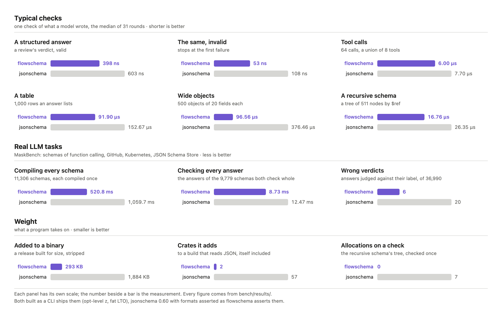

# Comparison

flowschema beside the [`jsonschema`](https://github.com/Stranger6667/jsonschema) crate, the
reference validator in Rust: both built as a CLI ships them (`opt-level = "z"`, fat LTO), both
asserting `format`. The method is in [bench/README.md](../bench/README.md); the tables between
the `bench` marks are written by `bench/run.sh` from `bench/results/`, and the machine they ran on
is in [bench/results/latest.md](../bench/results/latest.md).

  

## Typical checks

The checks an agent makes: a structured answer valid and not, rows and wide objects, a tree by
`$ref`, a union of tool calls, and single keywords. Each time is the median of 31 rounds, and the
allocations are counted exactly.

<!-- bench:micro -->

| check | flowschema | jsonschema 0.60 | flowschema faster by |
|---|---|---|---|
| review verdict, valid | 398 ns (0 alloc) | 603 ns (0 alloc) | 1.52x |
| review verdict, invalid | 53 ns (0 alloc) | 108 ns (0 alloc) | 2.05x |
| 1,000 rows | 91.90 µs (0 alloc) | 152.67 µs (0 alloc) | 1.66x |
| 500 objects × 20 fields | 96.56 µs (0 alloc) | 376.46 µs (0 alloc) | 3.90x |
| tree of 511 nodes by `$ref` | 16.76 µs (0 alloc) | 26.35 µs (7 alloc) | 1.57x |
| 64 tool calls, `oneOf` of 8 | 6.00 µs (0 alloc) | 7.70 µs (0 alloc) | 1.28x |
| `uniqueItems`, 1,000 strings | 6.43 µs (1 alloc) | 8.56 µs (1 alloc) | 1.33x |
| `enum` of 1,000, the last | 11 ns (0 alloc) | 21 ns (0 alloc) | 1.95x |
| `format: date-time` | 10 ns (0 alloc) | 19 ns (0 alloc) | 1.97x |
| `format: email` | 32 ns (0 alloc) | 166 ns (1 alloc) | 5.20x |
| `format: uuid` | 8 ns (0 alloc) | 10 ns (0 alloc) | 1.26x |
| `format: ipv4` | 9 ns (0 alloc) | 14 ns (0 alloc) | 1.53x |
| `format: uri` | 26 ns (0 alloc) | 46 ns (0 alloc) | 1.75x |
| `format: regex`, `^[a-z]+\d$` | 99 ns (0 alloc) | 154 ns (3 alloc) | 1.56x |
| `format: regex`, `^\p{L}+$` | 87 ns (0 alloc) | 136 ns (3 alloc) | 1.56x |
| `format: regex`, `^\P{ASCII}+$` | 105 ns (0 alloc) | 143 ns (3 alloc) | 1.37x |
| `format: regex`, `[\P{Letter}]` | 93 ns (0 alloc) | 146 ns (3 alloc) | 1.58x |
| `format: regex`, `(?=a)b` | 75 ns (0 alloc) | 147 ns (4 alloc) | 1.95x |
| `format: regex`, `(a)\1` | 77 ns (0 alloc) | 147 ns (4 alloc) | 1.90x |
| `format: regex`, `(?<n>a)\k<n>` | 105 ns (0 alloc) | 239 ns (7 alloc) | 2.28x |
| `pattern: ^[A-Z]{3}$` | 10 ns (0 alloc) | 39 ns (0 alloc) | 3.71x |
| `pattern: ^\d{4}-\d{2}-\d{2}$` | 13 ns (0 alloc) | 40 ns (0 alloc) | 3.18x |
| `pattern: ^[a-zA-Z0-9._%+-]+@[a-zA-Z0-9.-]+\.[a-zA-Z]{2,}$` | 14 ns (0 alloc) | 41 ns (0 alloc) | 3.01x |
| `pattern: ^(small\|medium\|large)$` | 10 ns (0 alloc) | 14 ns (0 alloc) | 1.42x |

| compiled once | flowschema | jsonschema 0.60 | flowschema faster by |
|---|---|---|---|
| review verdict | 6.95 µs | 15.09 µs | 2.17x |
| tool calls | 29.12 µs | 65.56 µs | 2.25x |

Every message of an invalid verdict: flowschema 1.49 µs, jsonschema 1.66 µs (1.11x).

<!-- /bench:micro -->

## Real LLM tasks

<!-- bench:corpus -->

| | flowschema | jsonschema 0.60 |
|---|---|---|
| schemas compiled | 11,306 of 11,306 (0 panics) | 11,298 (8 refused) |
| answers judged as labelled | 36,984 of 36,990 (99.98%) | 36,970 (99.95%) |
| compiling every schema | 520.8 ms | 1059.7 ms (flowschema 2.03x faster) |
| checking every answer of the 9,779 schemas both check whole | 8.73 ms | 12.47 ms (flowschema 1.43x faster) |

The two agree on 99.93% of the answers (`corpus-disagreements.tsv`). 21 schemas (0.19%) ask something not checked here: `pattern` (19), `$ref outside the schema` (1), `format` (1). flowschema is slower by over 5% on 350 schemas (`corpus-slower.tsv`).

<!-- /bench:corpus -->

## Size

<!-- bench:size -->

| added to a release binary built for size | size |
|---|---|
| flowschema, all of it | 293 KB |
| of which its own code | 244 KB |
| of which regex-lite | 49 KB |
| jsonschema 0.60 | 1,884 KB |

| crates added to the build, itself included | crates |
|---|---|
| flowschema | 2 |
| jsonschema 0.60 | 57 |

Over a program that reads the JSON alone (312 KB), stripped, `opt-level = "z"`, fat LTO. regex-lite is measured alone, as a program that uses it pays for it.

<!-- /bench:size -->

## How it is fast

- **Compiled once** into nodes: the types a bit mask, each bound in the order its message says
  it, every `$ref` the node it lands on, an `enum` of many options a hash table, a schema
  with nothing of a kind (no array keyword) a bit that skips the kind.
- **Objects in one pass**: the data's fields and the schema's `properties` are both sorted by
  name, so a cursor meets each field's schema in about one comparison; each required field
  sets a bit as it is met, and `required` is one comparison of masks, nothing looked up.
- **Tagged unions**: a `oneOf` or `anyOf` whose branches each require one field and hold it to
  their own strings (`"type": {"const": "read"}`), as tool calls are written, reads that field
  and tries only the branches its value names.
- **Patterns** by the cheapest matcher that takes them: a comparison or one scan for the common
  shapes (`^[A-Z]{3}$`, `^(small|medium|large)$`), else a position automaton simulated
  bit-parallel, else `regex-lite`; every one linear in the string, none backtracks.
- **`uniqueItems`** through an open-addressed set of the items' hashes (a hash that agrees with
  JSON's equality: `1` and `1.0` alike, an object's fields in any order).
- **Types alone folded**: an `anyOf` of types only, or a `oneOf` of types no two share, is one
  mask; a `$ref` to a schema that asks only a type is that type; an array whose items ask only
  a type, or are such arrays in turn, is checked in one loop over its items.
- **`unevaluated*` settled as it compiles**: where what a schema applies to every value
  (`$ref`, `allOf`) takes every field or item, nothing is left to evaluate and nothing is
  walked; elsewhere what was looked at is marked on the stack, and only once the rest holds.
- **A quick walk first**: `matches` stops at the first failure and writes nothing; only
  `mismatches` on data that failed walks again for every message.

## Where `jsonschema` suits better

- A schema that needs a pattern's lookaround or back-reference, an `idn-*` format, or a `$ref`
  fetched over the network: flowschema names these as unchecked; `jsonschema` checks them.
- Errors as structured values (a path, a keyword, a kind) for a program to branch on: flowschema
  writes messages, for a model to read.
- A schema whose cost is in one field order or in one `multipleOf` of a decimal: the schemas
  flowschema is slower on are listed in `bench/results/corpus-slower.tsv`.
