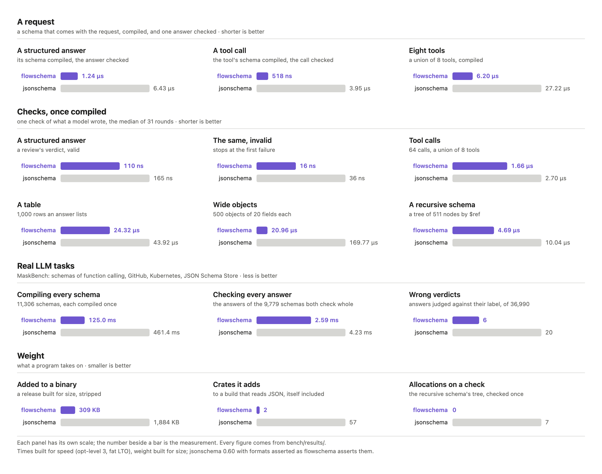

# Comparison

flowschema beside the [`jsonschema`](https://github.com/Stranger6667/jsonschema) crate, the
reference validator in Rust: both built as `cargo build --release` builds them (`opt-level = 3`),
with fat LTO and one codegen unit, both asserting `format`; the size is measured built for size.
The method is in [bench/README.md](../bench/README.md); the tables between the `bench` marks are
written by `bench/run.sh` from `bench/results/`, and the machine they ran on is in
[bench/results/latest.md](../bench/results/latest.md).

  

## Typical checks

The checks an agent makes: a structured answer valid and not, rows and wide objects, a tree by
`$ref`, a union of tool calls, and single keywords. Each time is the median of 31 rounds, and the
allocations are counted exactly.

<!-- bench:micro -->

| check | flowschema | jsonschema 0.60 | flowschema faster by |
|---|---|---|---|
| review verdict, valid | 92 ns (0 alloc) | 167 ns (0 alloc) | 1.82x |
| review verdict, invalid | 14 ns (0 alloc) | 34 ns (0 alloc) | 2.46x |
| 1,000 rows | 20.14 µs (0 alloc) | 47.38 µs (0 alloc) | 2.35x |
| 500 objects × 20 fields | 33.66 µs (0 alloc) | 171.79 µs (0 alloc) | 5.10x |
| tree of 511 nodes by `$ref` | 4.22 µs (0 alloc) | 11.40 µs (7 alloc) | 2.70x |
| 64 tool calls, `oneOf` of 8 | 1.52 µs (0 alloc) | 2.73 µs (0 alloc) | 1.80x |
| `uniqueItems`, 1,000 strings | 2.99 µs (1 alloc) | 5.06 µs (1 alloc) | 1.69x |
| `enum` of 1,000, the last | 5 ns (0 alloc) | 6 ns (0 alloc) | 1.23x |
| `format: date-time` | 7 ns (0 alloc) | 10 ns (0 alloc) | 1.52x |
| `format: email` | 22 ns (0 alloc) | 88 ns (1 alloc) | 4.03x |
| `format: uuid` | 4 ns (0 alloc) | 5 ns (0 alloc) | 1.33x |
| `format: ipv4` | 5 ns (0 alloc) | 7 ns (0 alloc) | 1.40x |
| `format: uri` | 14 ns (0 alloc) | 22 ns (0 alloc) | 1.55x |
| `format: regex`, `^[a-z]+\d$` | 58 ns (0 alloc) | 77 ns (3 alloc) | 1.33x |
| `format: regex`, `^\p{L}+$` | 50 ns (0 alloc) | 60 ns (3 alloc) | 1.20x |
| `format: regex`, `^\P{ASCII}+$` | 57 ns (0 alloc) | 66 ns (3 alloc) | 1.15x |
| `format: regex`, `[\P{Letter}]` | 50 ns (0 alloc) | 66 ns (3 alloc) | 1.34x |
| `format: regex`, `(?=a)b` | 57 ns (0 alloc) | 89 ns (4 alloc) | 1.55x |
| `format: regex`, `(a)\1` | 59 ns (0 alloc) | 89 ns (4 alloc) | 1.51x |
| `format: regex`, `(?<n>a)\k<n>` | 76 ns (0 alloc) | 139 ns (7 alloc) | 1.83x |
| `pattern: ^[A-Z]{3}$` | 6 ns (0 alloc) | 16 ns (0 alloc) | 2.68x |
| `pattern: ^\d{4}-\d{2}-\d{2}$` | 7 ns (0 alloc) | 17 ns (0 alloc) | 2.22x |
| `pattern: ^[a-zA-Z0-9._%+-]+@[a-zA-Z0-9.-]+\.[a-zA-Z]{2,}$` | 9 ns (0 alloc) | 18 ns (0 alloc) | 2.05x |
| `pattern: ^(small\|medium\|large)$` | 5 ns (0 alloc) | 6 ns (0 alloc) | 1.17x |

| compiled once | flowschema | jsonschema 0.60 | flowschema faster by |
|---|---|---|---|
| review verdict | 1.24 µs | 6.77 µs | 5.45x |
| tool calls | 6.46 µs | 26.93 µs | 4.17x |

| one request | flowschema | jsonschema 0.60 | flowschema faster by |
|---|---|---|---|
| review verdict: compiled, one answer checked | 1.22 µs | 6.45 µs | 5.30x |
| one tool call: compiled, one answer checked | 534 ns | 3.96 µs | 7.42x |
| nested models: compiled, one answer checked | 2.54 µs | 10.63 µs | 4.19x |

Every message of an invalid verdict: flowschema 594 ns, jsonschema 770 ns (1.30x).

<!-- /bench:micro -->

## Real LLM tasks

<!-- bench:corpus -->

| | flowschema | jsonschema 0.60 |
|---|---|---|
| schemas compiled | 11,306 of 11,306 (0 panics) | 11,298 (8 refused) |
| answers judged as labelled | 36,984 of 36,990 (99.98%) | 36,970 (99.95%) |
| compiling every schema | 129.8 ms | 471.8 ms (flowschema 3.64x faster) |
| checking every answer of the 9,779 schemas both check whole | 2.41 ms | 4.32 ms (flowschema 1.79x faster) |

The two agree on 99.93% of the answers (`corpus-disagreements.tsv`). 21 schemas (0.19%) ask something not checked here: `pattern` (19), `$ref outside the schema` (1), `format` (1). flowschema is slower by over 5% on 175 schemas (`corpus-slower.tsv`).

<!-- /bench:corpus -->

### Answer by answer

Over all of MaskBench flowschema is ahead; answer by answer it is not everywhere. Counted in
the processor's instructions, which are the same on every run where a time of a few nanoseconds
is not:

<!-- bench:answers -->

| answers of MaskBench | answers | instructions, jsonschema's over flowschema's | flowschema runs over 5% fewer on | over 5% more on |
|---|---|---|---|---|
| that match | 13,937 | 1.55x | 12,856 (92.2%) | 483 (3.5%) |
| that do not | 22,979 | 1.55x | 20,307 (88.4%) | 1,296 (5.6%) |

Of the 9,779 schemas both check whole that have answers, flowschema runs over 5% fewer instructions on the answers of 9,056 (92.6%) and over 5% more on those of 280 (2.9%). An answer is one `matches` and one `is_valid`, counted in the processor's instructions: the same on every run of one build, and not a time.

<!-- /bench:answers -->

Where flowschema runs more, it is mostly on an answer that does not match: `jsonschema` asks an
object's `required` names and the names it refuses before it reads a value, and so meets some
failures at once, where flowschema reads names and values in one pass. That one pass is what
makes an answer that matches cheaper, and asking the names first was tried four ways: each
slowed more answers than it sped up. The rest are mostly unions whose branches are told apart
by what they require, and objects keyed by a pattern.

## Size

<!-- bench:size -->

| added to a release binary built for size | size |
|---|---|
| flowschema, all of it | 309 KB |
| of which its own code | 260 KB |
| of which regex-lite | 49 KB |
| jsonschema 0.60 | 1,884 KB |

| crates added to the build, itself included | crates |
|---|---|
| flowschema | 2 |
| jsonschema 0.60 | 57 |

Over a program that reads the JSON alone (312 KB), stripped, `opt-level = "z"`, fat LTO. regex-lite is measured alone, as a program that uses it pays for it.

<!-- /bench:size -->

## How it is fast

- **Compiled once** into nodes: the types a bit mask, each bound in the order its message says
  it, every `$ref` the node it lands on, an `enum` of many options a hash table, a schema
  with nothing of a kind (no array keyword) a bit that skips the kind.
- **A schema object read in one pass** over its fields, every keyword it says kept where the
  draft knows it; the index of `$ref`s built only for a schema that has one; the document read
  where it is, and not copied.
- **Common leaves held as what they are**: a leaf that asks only for a type is a node of its own
  with no rules allocated, and `{}` is `true`; an `enum` of strings, a `const`, an integer
  between bounds and a string's own keywords are settled where the walk stands, held or surely
  not, with no walk of their rules. A property is told what its node asks, through a `$ref`
  too, so most fields are judged with no node read.
- **Objects in one pass**: the data's fields and the schema's `properties` are both sorted by
  name, so the quick walk of an object held to `properties`, `required` and
  `additionalProperties` meets each field's schema in about one comparison, told equal by two
  loads that overlap rather than a call to `memcmp`; each required field sets a bit as it is
  met, and `required` is one comparison of masks, nothing looked up.
- **Tagged unions**: a `oneOf` or `anyOf` whose branches each require one field and hold it to
  their own strings (`"type": {"const": "read"}`), as tool calls are written, reads that field
  and tries only the branches its value names.
- **Patterns** by the cheapest matcher that takes them: a comparison or one scan for the common
  shapes (`^[A-Z]{3}$`, `^(small|medium|large)$`), else a position automaton simulated
  bit-parallel, else `regex-lite`; every one linear in the string, none backtracks.
- **`uniqueItems`** through an open-addressed set of the items' hashes (a hash that agrees with
  JSON's equality: `1` and `1.0` alike, an object's fields in any order).
- **Types alone folded**: an `anyOf` of types only, or a `oneOf` of types no two share, is one
  mask; a `$ref` to a schema that asks only a type is that type; an array whose items ask only
  a type, or are such arrays in turn, is checked in one loop over its items.
- **`unevaluated*` settled as it compiles**: where what a schema applies to every value
  (`$ref`, `allOf`) takes every field or item, nothing is left to evaluate and nothing is
  walked; elsewhere what was looked at is marked on the stack, and only once the rest holds.
- **A way of its own for each shape of node**: as a schema is compiled, every node is given the
  function that walks its shape (an object in order, one keyed by a pattern, one held to the
  names it requires, a map, a list, a union, each kind of leaf, a `not` alone, and more), and a
  quick walk calls it with no question asked of what the node is. A shape added costs the
  others nothing.
- **A union's branches told before they are walked**: each branch is given the kinds of value
  it can hold at all (its types, its `enum`'s, its `const`'s), and one that cannot hold the
  value's is not walked. Where the branches each only require names of the object's
  properties (`oneOf: [{"required": ["a"]}, {"required": ["b"]}]`), each is told by the names
  the object has, in one pass over them and with nothing looked up.
- **`multipleOf` with no spelling of the number**: a fraction held to a divisor of few decimal
  places (`0.01`) is told by one multiplication and one division, exactly; only a number
  that does not fit so is spelled in decimal and divided as written.
- **A quick walk first**: `matches` stops at the first failure and writes nothing; only
  `mismatches` on data that failed walks again for every message.

## Where `jsonschema` suits better

- A schema it happens to walk faster: flowschema is ahead over all of MaskBench's answers, not on
  every one ("Answer by answer", above); the schemas it is slower on by over 5% in time are
  listed in `bench/results/corpus-slower.tsv`.
- A schema that needs a pattern's lookaround or back-reference, an `idn-*` format, or a `$ref`
  fetched over the network: flowschema names these as unchecked; `jsonschema` checks them.
- Errors as structured values (a path, a keyword, a kind) for a program to branch on: flowschema
  writes messages, for a model to read.
